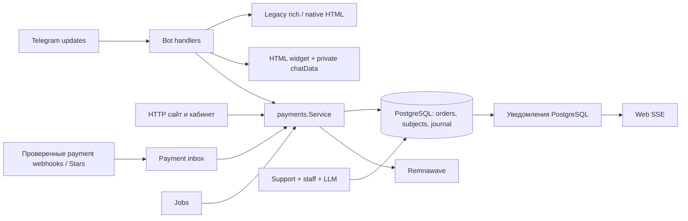
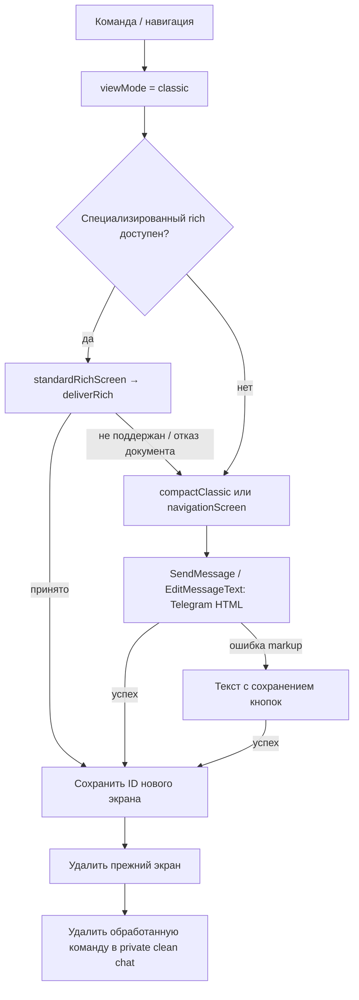
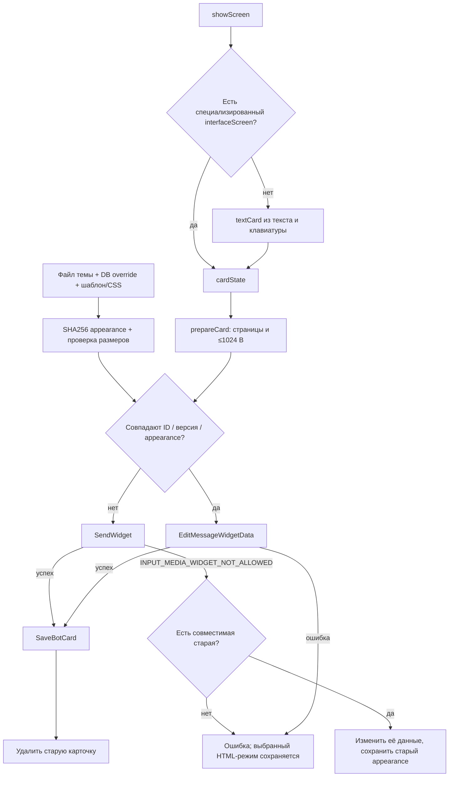
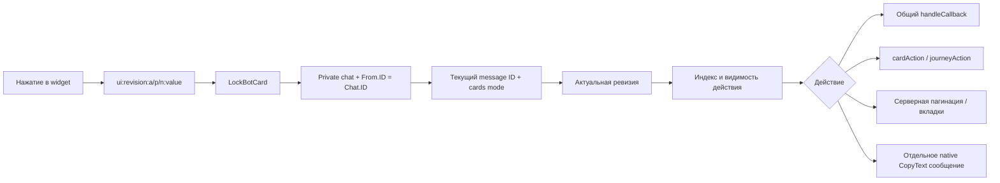
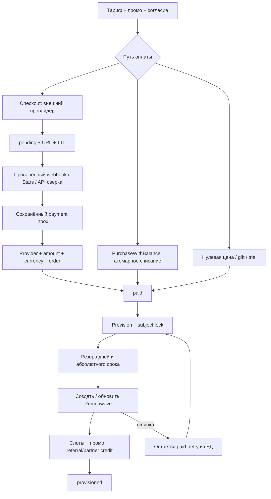
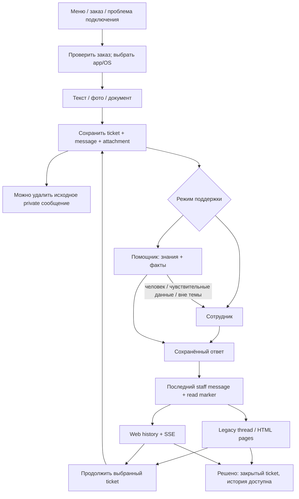

# Vivid: legacy и HTML — полный flow

Срез рабочей копии **16 ноября 2026**, включая текущие незакоммиченные изменения. Анализ относится к этому Go-проекту. Соседний Python-репозиторий не анализировался: слово legacy ниже означает `BOT_STYLE=legacy`.

## Как открыть карту

- [FLOW_MAP.html](FLOW_MAP.html) — последовательное чтение: 18 диаграмм, разделы сценариев, таблицы переходов, zoom/pan.
- [flow.html](flow.html) — интерактивный Graphify: 268 узлов, 419 направленных связей, 17 смысловых групп. Есть поиск и фильтры.
- [graph.html](graph.html) — весь код и смысловые связи: 2 837 узлов, 14 186 связей.
- [FLOW_CATALOG.md](FLOW_CATALOG.md) — каждый узел, описание, исходный файл и строка.
- [flow.json](flow.json), [graph.json](graph.json) — данные для `graphify query/path/explain`.

HTML-файлы открываются как локальные документы. Graphify загружает vis-network и Mermaid с CDN: для интерактивного отображения нужен доступ к ним. Для чтения Markdown/JSON сеть не нужна.

## 1. Архитектурная граница



Деньги и выдача общие для всех представлений. Переключение legacy → HTML меняет экран и транспорт, но не должно менять согласие на оплату, владельца заказа, сумму, сроки, журнал или доступные операции. Сайт с Go `html/template` — третье представление; Telegram parse-mode HTML — запасной транспорт legacy; Telegram HTML-widget — отдельный экспериментальный документ.

Запуск: `storage.Open` и миграции → `app_settings` → `config.Load` → стартовый каталог → Telegram/панель/реестр провайдеров → `payments.Service` → bot + web + jobs. Временный сбой long polling не останавливает HTTP и фоновые задания.

Источники: [main.go](../cmd/vivid/main.go), [config.go](../internal/config/config.go), [service.go](../internal/payments/service.go).

## 2. Вход и общая навигация

`/start` принимает `ref_` и `link_`. `link_` завершает привязку аккаунта; обычный старт открывает основной экран. `/view` при нормальной конфигурации больше не даёт персонального выбора: режим задаёт владелец через `BOT_STYLE`; `STYLE` — запасное имя, default — legacy. Старая ветка селектора сохранена для конфигурации с пустым `BotStyle`.

Зарегистрированы 26 команд. Разделы: `main`, `subscription`, `buy`, `trial`, `devices`, `profile`, `history`, `settings`, `promo`, `referral`, `support`, `info`, `help`, `more`, `connect`, `diagnostics`. Полный список команд и HTTP-маршрутов автоматически включён в каталог и граф.

Callbacks: `ann`, `ops`, `card`, `devices`, `view`, `widget`, `nav`, `plan`, `recurring`, `pay`, `payr`, `payb`, `check`, `dev`, `settings`, `promo`, `support`, `ticket`, `admin`, `poll`, `pw`, `ref`. Неизвестная кнопка получает сообщение об устаревшем действии.

Ввод текста: `promo`, `ticket`, `ticket_reply`, `poll_question`, `poll_options`, `broadcast`; время жизни — 20 минут. `/cancel` и переход через `showScreen` очищают режим ввода. Свободный текст вне выбранного диалога показывает подсказку с меню и поддержкой, автоматически обращение не создаётся.

`GuideCustomer` выбирает следующее действие в строгом порядке: paid без выдачи → активная подписка (recurring, trial, скорое истечение, недоступная панель, обычное подключение) → живой pending-счёт → известный будущий/истёкший срок → доступный trial → покупка. Эта модель подключена к HTML subscriptionCard, обычному mainScreen и веб-аккаунту. Основной richMain её не вызывает — это отдельный разрыв соответствия, а не отсутствие самой модели.

Источники: [register](../internal/bot/bot.go), [callbacks](../internal/bot/callbacks.go), [messages](../internal/bot/messages.go).

## 3. Legacy: фактическая доставка



Для `main/subscription/profile/history/settings/buy/devices` есть rich-варианты; часть остальных экранов строится через общую `cardState` и native/rich renderer. Кнопки встраиваются в rich-документ только когда выразимы все; иначе остаётся inline-клавиатура.

Fallback не означает бесконтрольный повтор: ошибка разметки допускает текст, сетевой отказ доставки возвращается как ошибка. Изменение тем же содержимым не считается отказом. При `BOT_CLEAN_CHAT=true` новая команда может создать экран внизу, навигация редактирует текущий. Старый ID удаляется после сохранения нового; неуспех записи сохраняет прежнюю точку восстановления.

Источник: [richscreens.go](../internal/bot/richscreens.go), [rich_standard.go](../internal/bot/rich_standard.go), [bot.go](../internal/bot/bot.go), [clean_chat.go](../internal/bot/clean_chat.go).

## 4. HTML: состояние, действия и восстановление



У `main` и `subscription` одна специализированная `subscriptionCard`; также есть devices, connect, profile, buy, support, more, diagnostics. Checkout и ticket имеют отдельные builders. Остальное превращается в `textCard`: текст теряет богатую структуру и делится на компактные страницы. Это функциональная совместимость, не доказательство одинаковой удобности и полноты всех экранов.

В БД хранится вся `cardState` с серверными `Actions`; в `TelegramWidget.chatData` передаётся текущая страница. HTML ≤32 KiB, zlib ≤4 KiB, приватная страница ≤1 KiB. Отправленный документ неизменяем: смена шаблона/темы требует нового widget, а не редактирования его HTML.



URL из текущей подготовленной страницы открывается синхронно нажатием, чтобы не потерять пользовательский жест. Изменения бизнес-состояния идут через сервер. Старый ID или revision отклоняется. Клиент использует `requestSerial`, ждёт `chatDataChanged` после пустого ack, снимает busy через 10 секунд и игнорирует устаревшие ответы. Галочка recurring меняется по серверному состоянию.

Отдельный старый `subscription.html` использует `subscription:refresh`. Команда `/status` сейчас вызывает обычный `showScreen(subscription)`; старый протокол не является основным универсальным HTML-flow.

Источники: [cards.go](../internal/bot/cards.go), [card_screens.go](../internal/bot/card_screens.go), [card_appearance.go](../internal/bot/card_appearance.go), [interface.html](../internal/bot/widgets/interface.html), [views.go](../internal/bot/views.go).

## 5. Покупка, триал, промо и выдача



Финансовые статусы: pending, paid, provisioned, failed, cancelled, refunded. Представление истёкшего счёта зависит от TTL, но возвращение с платёжного сайта не меняет оплату. `Order.Progress` различает выданную подписку, слоты и баланс. Для paid ошибка fulfillment или две минуты ожидания дают «Выдача задерживается» без повторного запроса денег.

`CheckOrder` вызывается после проверки владельца. Ошибка сверки сохраняет последний подтверждённый статус. Webhook подтверждается после сохранения inbox; неуспех применения события продолжается фоном. `HandleEvent` проверяет соответствие суммы/валюты/провайдера; repeated event не даёт второй срок. В текущем обработчике failed и cancelled для pending записываются как failed, хотя доменная модель отображает отдельный cancelled.

Выдача: lock subject → повторное чтение заказа → journal subscription_days → journal subscription_target → paid/trial profile → абсолютное обновление панели → trial traffic reset при необходимости → plan slots → promo activation → referral/partner credits → MarkProvisioned. Результаты шагов сохранены. Это позволяет продолжить выдачу после перезапуска и после успешного внешнего изменения с потерянным ответом.

Триал использует стабильный заказ и запись trial, сохранённые до панели. Активная подписка и повторный trial запрещены, bot/web каналы различаются. Скидочный промокод влияет на цену; gift выдаёт отдельный заказ. Лимиты и применимость проверяются снова на сервере.

Источники: [service.go](../internal/payments/service.go), [admin.go](../internal/payments/admin.go), [provision.go](../internal/payments/provision.go), [inbox.go](../internal/payments/inbox.go), [order_progress.go](../internal/domain/order_progress.go).

## 6. Автопродление

Тариф → явная галочка → `checkout_preferences` → фильтр возможностей merchant/provider/method → фиксация согласия и условий → первичная оплата клиентом → сохранённый метод → расписание. Варианты: YooKassa card; Platega sbp, срок до 730 дней. Поддержка API не равна разрешению конкретному merchant.

YooKassa-путь: проверка enabled/activated/externalID/даты → стабильный order ID периода → создание debit → обычные inbox и Provision → новый срок. Неизвестный исход создания платежа после 23 часов требует ручной сверки. Platega может сообщить отдельную внешнюю транзакцию своего расписания; она превращается в отдельный неизменяемый заказ.

Отмена из бота и сайта вызывает один `CancelRecurring`. Для Platega сначала требуется успешная внешняя отмена, затем local StopRecurring(user). Изменённые условия тарифа требуют нового согласия. В UI сохраняются user/declined/terms/review. Уже отправленное до отмены списание может завершиться позднее: срок должен быть выдан, а не потерян.

Источник: [recurring.go](../internal/payments/recurring.go), [checkout_cards.go](../internal/bot/checkout_cards.go), [account.html](../internal/web/templates/account.html).

## 7. Подключение и устройства

`Access` сначала читает панель: active, срок, URL, трафик, HWID devices. При недоступности панели БД может сохранить известный оплаченный срок; это не подтверждение текущего подключения. Сбой отдельного списка устройств не должен скрывать уже полученные срок и URL.

Действующий доступ + URL → хаб Happ / Incy / Clash Mi / FlClashX → HTTPS `/app-import/{app}` → deep link клиента. Нет HTTPS-сайта → ручное получение ссылки. Установка приложения идёт отдельной веткой platform → install → import. Диагностика проверяет подписку и места; реальную сеть на устройстве она не тестирует.

Устройства → страницы по три → устройство → последствия → подтверждение → удалить HWID → перечитать список. HTML хранит полный HWID серверно; legacy `dev:rm` использует хвост и отклоняет неоднозначность. Удаление записи не удаляет профиль приложения: устройство может появиться вновь.

Дополнительные места → актуальная пропорциональная цена → заказ устройств или продление grant → оплата → отдельная ветка Provision → SyncDeviceLimit. Sweeper через 10 минут понижает истёкший лимит только если распознаёт своё прежнее значение; ручные изменения панели не должны затираться.

Источники: [access.go](../internal/payments/access.go), [connect_hub.go](../internal/bot/connect_hub.go), [card_journey.go](../internal/bot/card_journey.go), [device.go](../internal/payments/device.go).

## 8. Поддержка



Список обращений, выбранная переписка и режим ввода — разные состояния. Ответ не должен попадать в другой открытый ticket; устаревший reply не открывает закрытый. В legacy помещающаяся переписка — одна раскрываемая цитата; длинная разбивается по лимиту, с переходом к последним сообщениям и полной истории на сайте. В HTML — компактные страницы `ticketCard`.

Прочтение фиксирует конкретный последний ответ; фоновая доставка или просмотр сотрудником его не снимают. На сайте SSE и JS учитывают видимость вкладки. Вложения отдаются авторизованным маршрутом без bot token/fileID; загрузка новых файлов через веб в текущий этап не входит. Internal notes клиенту не показываются.

Компенсация: открытый ticket → permission → транзакция лимита/истории/аудита и paid-заказа на 3 дня → общая выдача. Один ticket — один заказ. При отказе панели лимит уже занят и остаётся занят; повтор продолжает этот заказ. Отдельное Telegram-уведомление не определяет успешность самой компенсации.

Источники: [support_lifecycle.go](../internal/bot/support_lifecycle.go), [ticket_thread.go](../internal/bot/ticket_thread.go), [ticket_cards.go](../internal/bot/ticket_cards.go), [live.go](../internal/web/live.go), [compensation.go](../internal/payments/compensation.go).

## 9. Операции и фон

| Сценарий | Переходы и условия |
| --- | --- |
| Очередь проблем | Вся очередь attention → первые 6 в Telegram / до 150 в веб → paid + orders.retry → CheckOrder + аудит; нового счёта нет |
| Рассылка | broadcast.send → frozen audience → текст и promo= → preview → confirm до 20 минут → очередь → итоги |
| Доставка рассылки | Роль автора проверяется перед получателем; 429 переносится; timeout/5xx — unknown без автоматического дубля |
| Опрос | staff → вопрос → варианты → отправка → ответы/результаты; отдельный flow от broadcast |
| Партнёр | staff создаёт → приглашение → авторизация получателя → привязка → начисления с заказов |
| Ручная выдача | /grant → проверка роли → служебный заказ → общая выдача |
| Событие панели | HMAC сырого тела → минимальные данные и body hash → дедуп → cooldown → уведомление Telegram |

| Задание | Интервал | Что доводит |
| --- | --- | --- |
| Платежи | 1 минута | ReconcilePayments(25), inbox(50), ProvisionPending(25), recurring(25) |
| Истечение подписки | 15 минут | Окно 24 часа, настройки, reminder claim, отдельный recurring-текст |
| Неоплаченный счёт | 30 минут | Включённый срок, activity, claim в БД |
| Истечение слотов | 10 минут | Расчёт/синхронизация лимита, отметка выполненного снижения |
| LLM | 20 секунд | Новые обращения при включённом помощнике |
| Idle support | 1 час | Передача зависших обращений сотрудникам |
| Panel events | 5 секунд | До 20 уведомлений, политика 429/unknown |
| Broadcasts | 2 секунды | До 20 доставок с проверкой прав |

Каждый `every` выполняется сразу при старте, затем по таймеру. Ошибка итерации логируется и цикл продолжается. Источник: [jobs.go](../internal/jobs/jobs.go).

## 10. Матрица соответствия представлений

| Функция | Legacy | Telegram HTML | Веб |
| --- | --- | --- | --- |
| Начало / подписка | Специализированный rich, компактный fallback | Общая subscriptionCard для main/subscription | landing/account |
| Тарифы | richBuy / buyScreen | buyCard | buy template |
| Checkout | planScreen | checkoutCard, серверный checkbox | POST /buy, consent формы |
| Счёт и Progress | Текст/rich + кнопки | Обычно универсальный textCard | pay_result/account |
| Подключение | Общая cardState → native/rich | connectHub + journey | connect/app-import; тексты расходятся |
| Устройства | Общая модель + native страницы | Специализированные страницы | account формы |
| Промо / настройки / рефералы | Rich или native | Часть через textCard | account POST |
| Поддержка | Разворачиваемая история и части | ticketCard, компактные страницы | Полная лента, SSE, files |
| Рассылки / admin / polls | Native/rich и текстовый ввод | Универсальная адаптация не доказывает UX parity | Часть операций в админке; broadcast UI в веб не реализован |
| Ошибка транспорта | Rich → Telegram HTML → plain при markup | Возврат ошибки, сохранённый HTML mode | HTTP notice/flash/error |
| Восстановление | Native ID + данные в БД | Card state + actions + messageID + revision в БД | Сессия/заказы/история в БД |
| Незавершённый текстовый ввод | Память, 20 минут | Та же память | Контекст формы/HTTP; DB ticket после сохранения |

Существование `textCard` не гарантирует перенос произвольной клавиатуры: `deliverCard` отвергает кнопки без callback/URL/CopyText. Режимы share callback rules, но не все особенности представления.

## 11. Обнаруженные разрывы и приоритеты

Это результаты статического анализа. Они отмечают наблюдаемое поведение и места проверки, а не отчёт о production-инцидентах. Код приложения здесь не исправлялся.

| Приоритет | Наблюдение | Влияние и следующий шаг |
| --- | --- | --- |
| P1 | `REMIND_NOT_CONNECTED_HOURS` читается и влияет на видимость activity toggle, но в jobs нет соответствующего reminder | Настройка не приводит к такому уведомлению. Реализовать задание или убрать обещание функции. Сверить [config](../internal/config/config.go), [UI](../internal/bot/ui.go), [jobs](../internal/jobs/jobs.go). |
| P1 | Основной legacy richMain не вызывает общую CustomerGuidance, которую используют mainScreen, HTML и веб | Приоритет «paid, выдача задерживается → проверить заказ» не добавляется на rich-главную так же, как на другие представления. Подключить общую модель и сверить одинаковый next-step. [richMain](../internal/bot/richscreens.go), [subscriptionCard](../internal/bot/card_journey.go), [GuideCustomer](../internal/domain/customer.go). |
| P1 | Berloga landing безусловно пишет «Автосписаний нет» и ручное продление; buy/account поддерживают recurring | При включённом recurring витрина вводит в заблуждение. Делать текст зависимым от настройки. [landing](../web/themes/berloga/templates/landing.html). |
| P1 | Встроенная очередь admin_tickets показывает строки без ссылки на обращение | Переход из очереди к ответу неочевиден, хотя ticket route и staff-доступ есть. [admin_tickets](../internal/web/templates/admin_tickets.html), [support](../internal/web/support.go). |
| P2 | Веб-инструкции перечисляют HAPP/Streisand/v2rayNG; bot hub и support — Happ/Incy/Clash Mi/FlClashX | Пользователь получает разные наборы клиентов. Один реестр приложений и согласованные инструкции. [connect](../internal/web/templates/connect.html), [Berloga connect](../web/themes/berloga/templates/connect.html), [hub](../internal/bot/connect_hub.go). |
| P2 | `inputState` хранится в памяти, в отличие от карточек и истории | После рестарта недописанный promo/support/poll/broadcast теряет режим. Явно показать повторный вход или хранить draft, если это требование продукта. [bot.go](../internal/bot/bot.go). |
| P2 | Для текущей версии widget URL ветка серверной ошибки советует `/view`, а cfg запрещает персональное переключение | Если клиент попадёт в эту запасную ветку, подсказка не решит проблему. Основной путь URL синхронный и её обходит. [cards.go](../internal/bot/cards.go), [views.go](../internal/bot/views.go). |
| P2 | Веб `finishCheckout` для checkout.Free пишет «доступ выдан», хотя balance-путь может вернуть paid после сбоя панели | Успех списания и успех выдачи следует различать и в flash-тексте, как это делает Progress. [finishCheckout](../internal/web/pages.go), [PurchaseWithBalance](../internal/payments/admin.go). |
| P3 | ticket.html содержит недостижимую подпись о повторном открытии закрытого обращения | Убрать мёртвый текст; фактическая бизнес-логика правильно отклоняет reply к closed. [ticket](../internal/web/templates/ticket.html). |
| P3 | Документы расходятся по 40/42 экранам, старой истории tickets и последним 50/150 заказам | Привести документы к ScreenCatalog, expandable thread и глобальной attention queue. |

Для HTML перед эксплуатацией нужны: реальный SendWidget на нужном Telegram API; edit и замена appearance; отправка native copy; stale revision/message; restart; два быстрых нажатия; лимиты длинных русских текстов; checkout checkbox; support attachment/history/read. Demo-каталог и изученные тесты не заменяют эту проверку.

## 12. Данные, достоверность и воспроизводимость

Прочитаны до конца 55 документов/шаблонов и один JS-тест виджета. AST: 259 code-файлов, 2 334 узла, 13 103 связи. Среди них тесты: их вызовы означают связи тестового кода, а не runtime-переходы приложения. Семантический слой: 503 узла с flow, документацией и шаблонами. Flow-граф вручную ограничен пользовательскими сценариями, командами и маршрутами.

У каждого flow-узла разрешена ссылка на реально существующий исходный файл и строку; 130 также связаны с AST-символом. Нет оборванных/пустых конечных точек, self-loop или точных дублей. У полного графа 14 186 исходных связей и 14 162 уникальных направленных пар: 24 параллельные связи с разной семантикой сохранены в JSON multigraph. Внутренняя кластеризация DiGraph работает по уникальным парам; она не является доказательством потери исходных рёбер. У flow-графа 419 уникальных направленных пар, схлопывания нет.

`EXTRACTED` — явно найденное поведение кода/текста, `INFERRED` — вывод/междокументная привязка/предложение, `AMBIGUOUS` — расходящиеся утверждения. `proposed` у future-узлов означает задачу развития, не уже работающую функцию. Кратчайший путь графа может выбрать бесплатную покупку вместо внешней оплаты: это математически допустимый путь, а не автоматически выбранный сценарий клиента. Для оплаты использовать seed `flow_invoice`.

SQL AST не получен: в установленном Graphify нет `tree_sitter_sql`; 9 SQL-файлов не дали AST-символов. БД представлена репозиториями, семантическими узлами и проверенными миграциями. Из смысла исключены 7 иллюстраций и 2 лицензии шрифтов. .env, рабочие логи и исключённые каталоги не индексировались. Счётчики токенов этого сеанса не доступны и не заявляются как нулевые расходы.

Проверены JSON-схема, endpoints, coverage, исходные якоря, сохранность параллельных связей, `graphify path`, `explain`, `diagnose` и генерация HTML. Визуальный просмотр в управляемом браузере не подтверждён: localhost дал timeout, а прямой file URL запрещён политикой браузера. Реальные платежи, Telegram widget и production-панель не вызывались; тесты приложения не запускались, поскольку изменены только артефакты анализа.

```powershell
graphify query "HTML widget и подтверждение оплаты" --graph graphify-out/graph.json --depth 3
graphify explain flow_widgetguard --graph graphify-out/flow.json
graphify path flow_invoice flow_ready --graph graphify-out/flow.json
graphify path flow_support flow_resolve --graph graphify-out/flow.json
graphify diagnose multigraph --graph graphify-out/flow.json
```

Снимок источников и coverage: [coverage.json](coverage.json); метрики: [metrics.json](metrics.json); диагностика: [graph-health.json](graph-health.json). Построение смыслового слоя: [build_flow_map.py](build_flow_map.py). Для обновления сначала переизвлечь AST и заменить `.graphify_ast.json` новым AST-снимком; затем выполнить скрипт и экспорты. Автоматическое `graphify update` не заменяет ручной пересмотр семантических сценариев после изменения поведения.

`graphify-out/` создан в рабочем дереве; можно сохранить нужные артефакты в репозитории или добавить каталог в ignore. Остальные текущие изменения пользователя сохранены.
